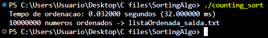

# DESAFIO DE SORTING 

Competição para organização de uma lista em tempo mínimo com o objetivo de realizar a Implementação e otimização de algoritmos de ordenação em linguagem C para ordenar uma base volumosa de dados no menor tempo de processamento possível.  

O algoritmo ultilizado foi **Counting Sort** de Complexidade:  

      Temporal: O(m+n) em todos os casos; 
      Espaço: O(n+m) que não foi um requisito; 

============== INSTRUÇÕES DE COMPILAÇÃO ==================  

A lista à ser ordenada deve ser um .txt no mesmo diretório onde o executável está 

Compilar -> gcc -O2 -o counting_sort Sorting.c  
Executar -> ./counting_sort  

Se quiser escolher o arquivo e dar um nome a lista de saída organizada:
Executar -> ./counting_sort entrada.txt saida.txt  

A entrada padrão é **listaOdenada.txt** e a saída é listaOrdenada_saida.txt.  

=====================================================  

Se o arquivo tiver um valor que não seja inteiro ou que não caiba em int,  
o programa informa o arquivo e a linha do erro e termina com código de saída 1.  

================= Tempo de Execução =================  

  

================================================  

